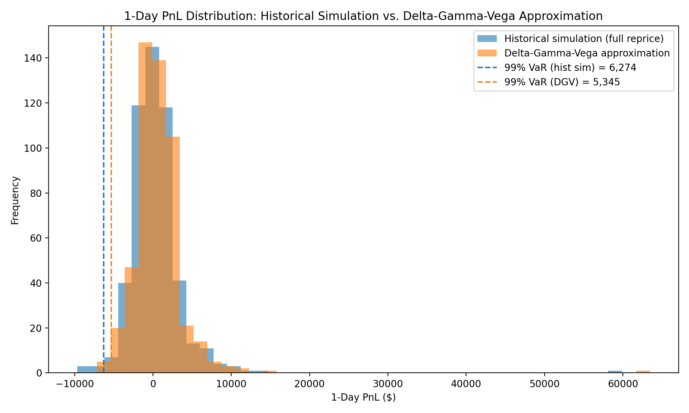
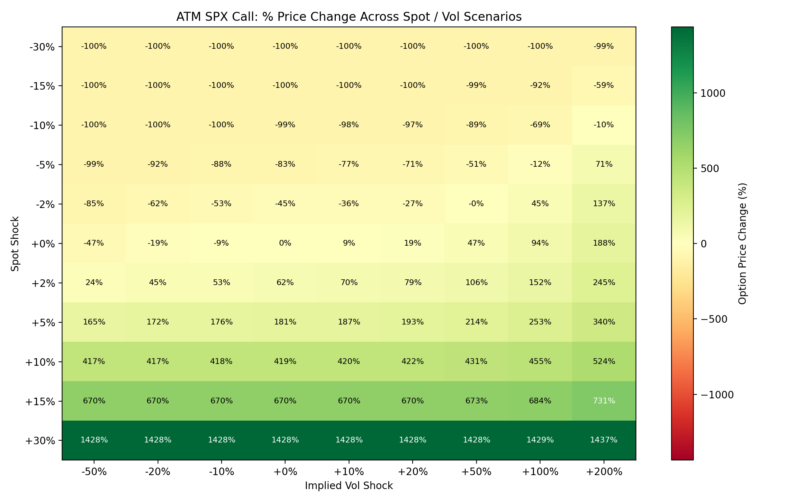
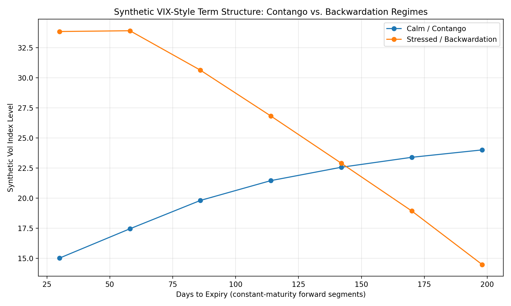
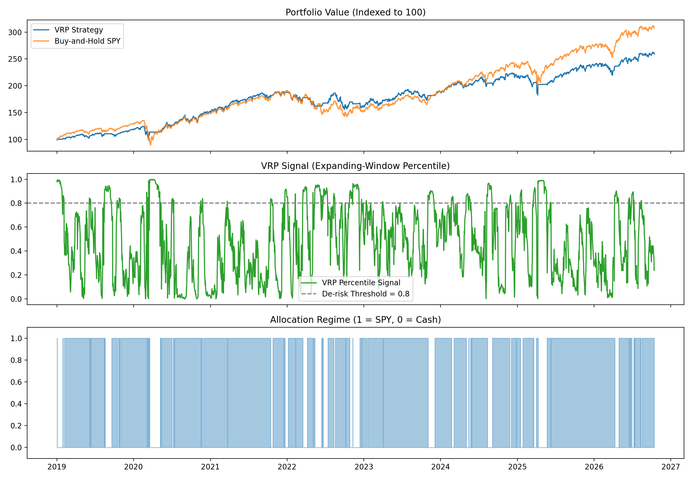
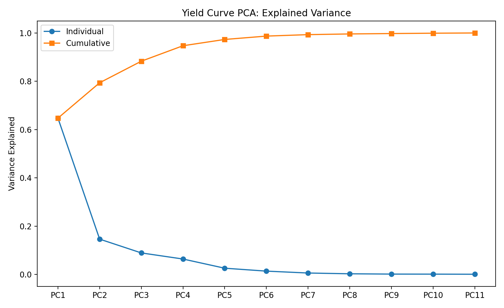
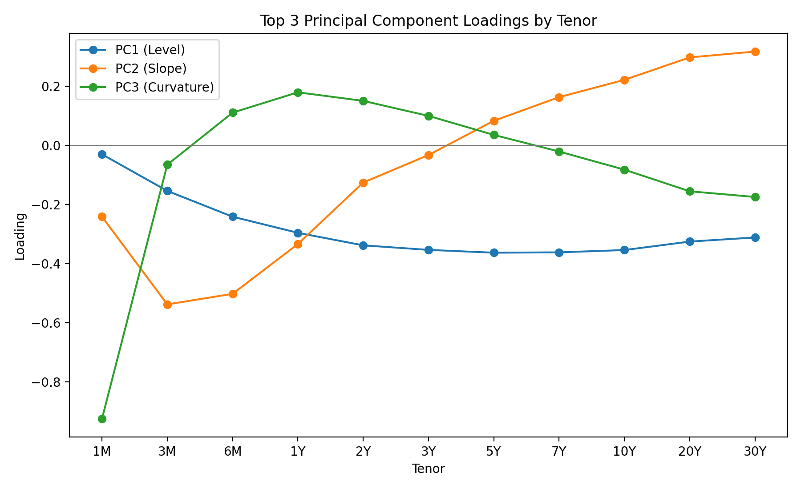
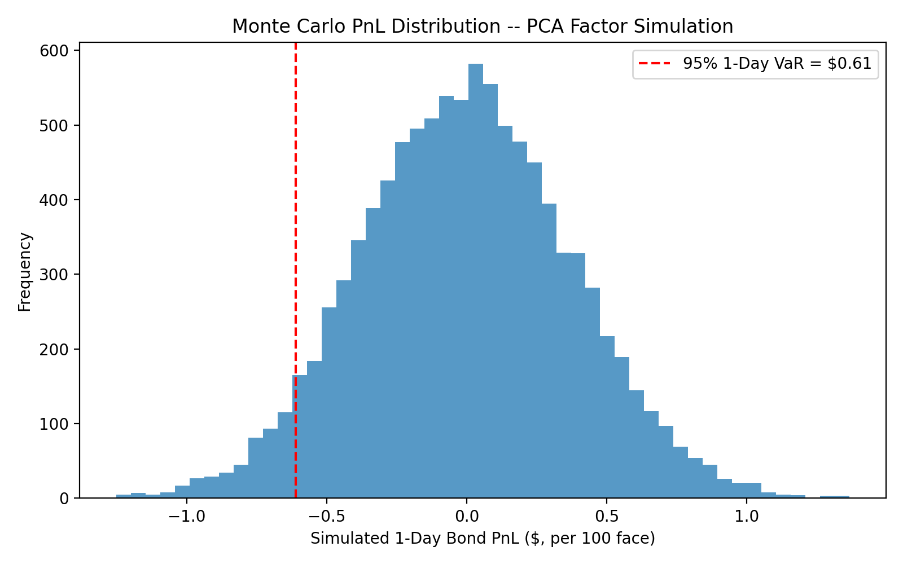
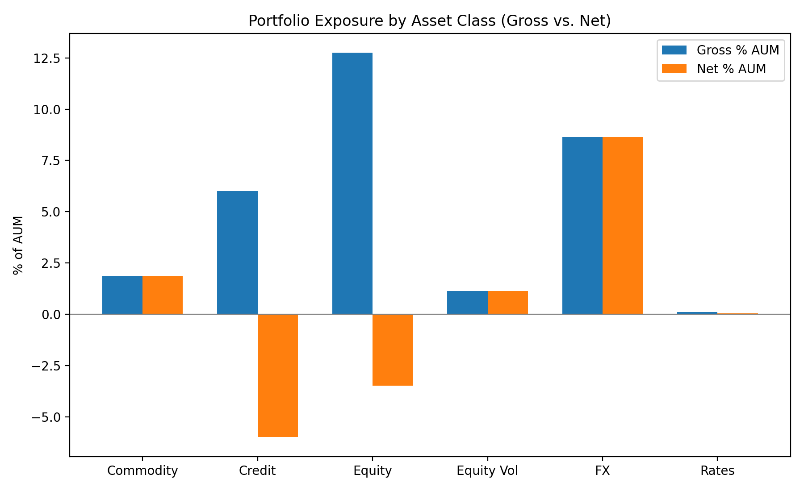
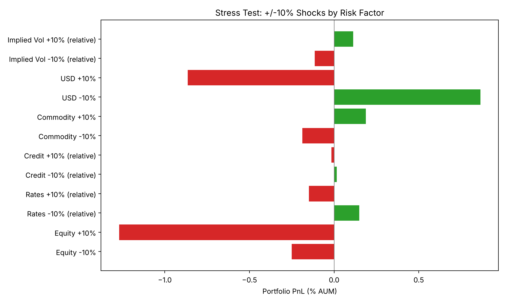

# Multi-Asset Risk & Volatility Analytics

A self-contained quantitative risk project covering four areas of markets risk and
investment analytics: **market risk (VaR)**, **volatility derivatives & systematic
vol strategies**, **interest rate factor risk**, and **institutional portfolio risk
reporting**. Built independently, end to end, on public data only — no proprietary
data, vendor feeds, or employer materials of any kind — so it's fully reproducible
by a reader with no data subscription.

Each module is a standalone, runnable Python script with its own methodology
docstring, saved tables, and charts — read the code, not just the results.

```
src/
  common/          Black-Scholes pricer + Greeks, cached data loaders (Yahoo Finance, FRED)
  market_risk/      VaR: historical simulation vs. parametric Delta-Gamma-Vega vs. closed-form
  volatility/        VIX-style term structure replication + a VRP systematic trading strategy
  rates/              Yield curve PCA factor model + bond sensitivity + Monte Carlo VaR
  portfolio_risk/   Multi-asset exposure, margin-to-equity, sensitivities, stress testing
outputs/
  tables/    CSV output from every module
  charts/    PNG charts from every module
run_all.py    regenerates everything in one pass
```

## Quickstart

```bash
pip install -r requirements.txt
python run_all.py          # runs all 5 analyses, writes outputs/tables and outputs/charts
# or run one module at a time:
python -m src.market_risk.var_analysis
python -m src.volatility.vix_term_structure
python -m src.volatility.vrp_strategy
python -m src.rates.yield_curve_pca
python -m src.portfolio_risk.exposure_report
```

Everything except `vix_term_structure.py` (fully synthetic, no network needed) pulls
live data the first time it runs and caches it to `data_cache/` for reproducibility.

---

## 1. Market Risk — VaR Methodology Comparison

`src/market_risk/var_analysis.py`

A 1-day 99% VaR for a single SPX option position, computed three ways on the same
trailing-year SPX/VIX return sample so the methods are directly comparable:

| Method | 1-Day 99% VaR |
|---|---|
| Historical simulation (full Black-Scholes repricing) | **$6,274** |
| Delta-Gamma-Vega Taylor approximation | **$5,345** |
| Analytic parametric (closed-form, joint-normal) | **$7,347** |

The DGV approximation understates tail risk relative to full repricing (it misses
higher-order convexity in the worst historical days), while the analytic parametric
method overstates it (normality assumes fatter simultaneous spot/vol moves than
the empirical sample actually produced) — exactly the trade-off risk teams weigh
when choosing a VaR engine for speed vs. accuracy.

The module also runs the position through four historical crisis windows
(Dot-com, GFC, COVID, Aug-2024 vol shock) and produces a full spot/vol sensitivity
heatmap.




---

## 2. Volatility — VIX Replication & a Volatility Risk Premium Strategy

### 2a. VIX-style term structure replication
`src/volatility/vix_term_structure.py`

Implements the CBOE model-free variance-swap replication formula (the actual VIX
calculation) end to end: OTM strike selection, trapezoidal `ΔK` weights, forward
via put-call parity, variance integral. Rather than depend on a live option feed
(flaky outside market hours, and licensed in production), it generates an
illustrative option chain from a parametric vol surface and recovers the fair-value
curve from it — which lets it self-validate: a flat input surface round-trips to
within 0.05 vol points (pure grid-discretization error), and a skewed surface
correctly reproduces the well-known **variance-swap convexity premium** (the fair
strike sitting above ATM vol because the replication formula weights the wings by
`1/K²`).



### 2b. Volatility Risk Premium (VRP) regime-switching strategy
`src/volatility/vrp_strategy.py`

`VRP = VIX − trailing 21-day realized SPX vol`. The strategy de-risks into cash
(SOFR accrual) whenever VRP sits in the bottom of its own expanding-window
percentile distribution — i.e. when the options market is pricing unusually
little insurance relative to its own history — and holds SPY otherwise. Backtest,
2019-01-02 through latest, SPX/VIX/SPY from Yahoo Finance, SOFR from FRED:

| | VRP Strategy | Buy-and-Hold SPY |
|---|---|---|
| Annualized Return | 13.0% | 15.6% |
| Annualized Volatility | **15.9%** | 19.3% |
| Sharpe Ratio | **0.82** | 0.81 |
| Max 1-Month Drawdown | **-19.5%** | -33.1% |

The strategy gives up some raw return but meaningfully improves risk-adjusted
return and drawdown control — it was in cash ~18% of trading days, concentrated
around the volatility spikes that produced SPY's worst drawdowns.



---

## 3. Rates — Yield Curve PCA Factor Model

`src/rates/yield_curve_pca.py`

Three-factor PCA on daily changes in the FRED Treasury par curve (11 tenors,
2015–present), textbook level/slope/curvature decomposition:

| PC | Interpretation | Variance Explained |
|---|---|---|
| PC1 | Level | 64.8% |
| PC2 | Slope | 14.6% |
| PC3 | Curvature | 8.9% |
| **Cumulative** | | **88.3%** |




The factor loadings are then un-standardized back into real yield-shift units and
used to shock the curve and reprice a 10Y 4% semi-annual bond, giving a $-per-unit-PC-score
sensitivity for each factor (R² = 1.00 — bond price is essentially linear in yield
over this shock range). Feeding the *actual* historical covariance of the three PC
score series through those sensitivities via Monte Carlo (10,000 draws) gives a
1-day 95% VaR of **$0.61 per 100 face**.



---

## 4. Portfolio Risk — Multi-Asset Exposure, Margin, and Stress Testing

`src/portfolio_risk/exposure_report.py`

Reimplements the exposure / margin-to-equity / sensitivity / stress-test
methodology used by the **Open Protocol (OPERA)** hedge-fund risk-transparency
standard — delta-adjusted notional for options, 10Y-equivalent DV01 for rate
products, aging-adjusted vega notional for variance swaps, notional for CDX/FX —
applied to a synthetic 9-position, $250mm illustrative macro book spanning Equity,
Rates, Credit, Commodity, and FX. (Open Protocol itself is a public AIMA
standard; this is my own report format, not the licensed template, and the
portfolio is made up for this project, not a real fund's book.)



Margin-to-equity: **3.08%**. Full Delta/Gamma/Vega/Theta/DV01/CS01 breakdown by
position in `outputs/tables/portfolio_sensitivities.csv`.

Stress test (±10% isolated shocks per risk factor, fully repriced):



Worth noting: the book loses money on **both** equity directions (-0.25% on -10%,
-1.27% on +10%) — the short-call overlay's negative gamma means losses accelerate
faster on the upside than the premium collected can offset on the downside. That
asymmetry only shows up under full repricing, not a linear delta estimate — the
same point Module 1 makes about VaR methodology choice.

---

## Data & methodology notes

- All market data is public: Yahoo Finance (`^GSPC`, `^VIX`, `SPY`) and FRED
  (Treasury CMT par yields, SOFR) — no paid terminal required, no proprietary data
  redistributed.
- The VIX term-structure module and the portfolio-risk module use clearly-labeled
  synthetic inputs (a generated vol surface, a made-up portfolio) specifically so
  the methodology can be demonstrated without depending on licensed data or
  real position data.
- Simplifications are flagged inline in docstrings where they matter (e.g. pricing
  bonds off interpolated par yields rather than a bootstrapped zero curve).
